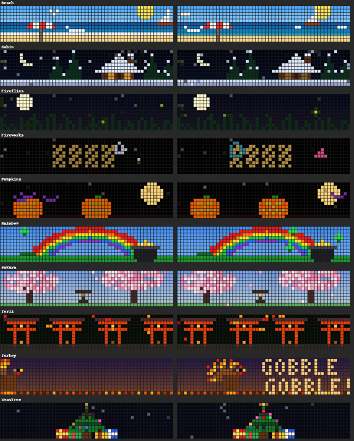

# Galactic Unicorn: a year of little scenes

A carousel of pixel-art scenes for the [Pimoroni Galactic Unicorn](https://shop.pimoroni.com/products/space-unicorns?variant=40842033561683) (53×11 LEDs, Pico W) that follows the calendar. You get pumpkins and ghosts in October, a snowy cabin in December, cherry blossoms and rainbows in spring, and fireflies and the beach in summer. There are also scenes for US holidays, from the big ones down to Pi Day, Juneteenth and Groundhog Day.

A Raspberry Pi (or any always-on Linux box) on the same Wi-Fi sends it the time, the local weather and a few Japanese words a day. No data cable needed after the first setup.



*(The simulator draws text as rough blocks; on the real board it's proper lettering.)*

## What's in it

- **About 50 scenes through the year.** Each month has its own scenes, in `winter.py`, `spring.py`, `summer.py`, `fall.py` and `carousel.py`.
  - October: Halloween and autumn in Japan (the torii gates of Fushimi Inari, Kinkaku-ji, Mt Fuji with the shinkansen).
  - Other scenes: Thanksgiving, Christmas, New Year fireworks, Valentine's, St. Patrick's, Easter, Earth Day, Cinco de Mayo, Mother's and Father's Day, the 4th of July, back to school, and more.
- **Countdowns for the big holidays only.** These are Halloween, Thanksgiving, Christmas, New Year, Valentine's, Easter and the 4th of July. The smaller days get a greeting on the day.
- **Gift reminders** 10 and 5 days before Mother's Day and Father's Day ("Did you get a gift?"), shown all day.
- **Local weather** from [Open-Meteo](https://open-meteo.com) (free, no API key):
  - **Forecast:** pages with the temperature, the conditions, the high and low, and what's coming ("storms at 4pm").
  - **Outside:** the sky right now, with the sun or moon in the right place, clouds, rain, snow and lightning.
  - **Moon:** the moon's phase.
  - **Weather-aware scenes:** they show up more when they match the weather outside (thunderstorms when it's storming, the beach or a kite on a sunny day, the aurora on a clear winter night).
- **Kotoba:** Japanese flashcards, 10 new words a day from `kotoba/words.tsv` (swap in your own list).
- **A clock** with a little seasonal icon, and custom scrolling messages.

**Buttons:** A = next scene, B = weather, C = clock, D = hold this scene, LUX +/- = brightness, SLEEP = screen on/off.

## Setup

You need:
- A Galactic Unicorn with Pimoroni's **MicroPython v1.21.0** firmware ([`galactic_unicorn` build](https://github.com/pimoroni/pimoroni-pico/releases/tag/v1.21.0)).
- A Pi running Python 3.

```sh
git clone https://github.com/OriginalName457/galactic-unicorn.git ~/galactic-unicorn
cd ~/galactic-unicorn
pip install mpy-cross==1.21.0 mpremote      # the carousel is precompiled: it's too big for the board to compile itself

cp secrets_example.py secrets.py            # your Wi-Fi name and password
./install.sh --usb                          # first time, over a USB data cable
python3 weather/weather.py place "Portland, OR" # your town (or: place LAT LON "Name")
```

After the first install, updates go over Wi-Fi: `./install.sh`.

`install.sh` sets up three services on the Pi:
- `unicorn-sync` keeps the clock right.
- `weather.timer` sends the weather every 20 minutes.
- `kotoba.timer` sends the day's words.

## Talking to it

```sh
python3 unicorn.py say Happy birthday!      # a custom message in the carousel (`clear` removes it)
python3 unicorn.py bright 30                # brightness, percent
python3 unicorn.py sound chime              # tunes: beep chime love sakura spooky fanfare doorbell konbini
python3 unicorn.py pretend 2026 12 24       # preview another day's scenes (`pretend` alone goes back)
python3 unicorn.py next                     # skip ahead
python3 unicorn.py perf                     # how fast each scene draws, and free memory
```

`python3 unicorn.py` lists all the commands.

## Making scenes

A scene is a class with a `dur` (seconds) and a `draw(self, t, dt)` that paints a frame with PicoGraphics. Add it to `SCENES` with the dates it should show:

```python
SCENES = [
    (Orchard, during(9, 1, 10, 20), 1),               # Sep 1 - Oct 20, once per round
    (Turkey, around("Thanksgiving", 24, 1), 2),       # 24 days before Thanksgiving to 1 after, twice per round
]
```

You can preview a scene without the board. The simulator writes a PNG of the chosen frames:

```sh
python3 sim.py carousel.py winter.Cabin 1,4,7 out.png "(2026,12,20,19,0,0)"
```

## Experimental: the Unicorn as a Wi-Fi speaker

`firmware/` builds Pimoroni's v1.21.0 firmware with one addition: audio can be streamed into the speaker while the animations keep running. `speaker/` makes it the Pi's default sound output. Sound is sent only while something is playing.

This part is **untested on real hardware so far**.

To try it:
1. Build the firmware: `firmware/fetch.sh`, then `firmware/build.sh`.
2. Flash it over a USB data cable: `firmware/flash.sh`. Your files on the board are kept.
3. Enable the Pi side: `systemctl --user enable --now unicorn-speaker`.

## Credits

Built on [Pimoroni's pimoroni-pico](https://github.com/pimoroni/pimoroni-pico) libraries and MicroPython. The weather comes from [Open-Meteo](https://open-meteo.com).
