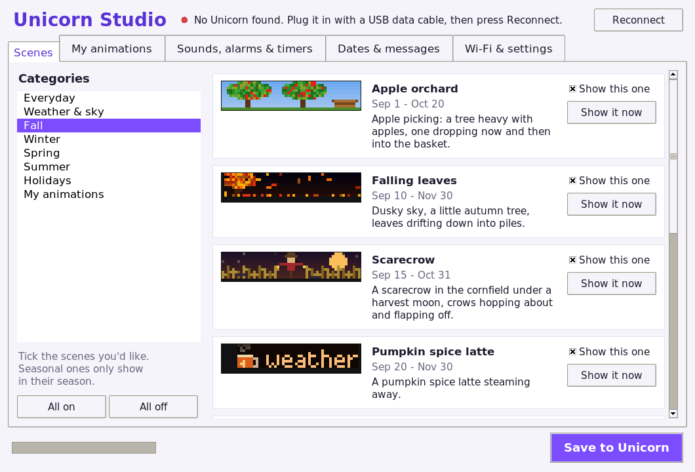

# Galactic Unicorn: a year of little scenes

A carousel of pixel-art scenes for the [Pimoroni Galactic Unicorn](https://shop.pimoroni.com/products/space-unicorns?variant=40842033561683) (53×11 LEDs, Pico W) that follows the calendar. You get pumpkins and ghosts in October, a snowy cabin in December, cherry blossoms and rainbows in spring, and fireflies and the beach in summer. There are also scenes for US holidays, a clock, the local weather, alarms and timers, and your own birthdays and messages.

It comes with **Unicorn Studio**, a double-click app for Windows, Mac and Linux that sets the whole thing up and lets you choose what it shows. No programming needed.



## Getting started (no programming)

1. **Download Unicorn Studio** for your computer from the [latest release](https://github.com/OriginalName457/galactic-unicorn/releases/latest), and unzip it.
2. **Plug the Unicorn into your computer with a USB data cable.** Some USB cables only carry power; if Unicorn Studio can't find the Unicorn, try another cable.
3. **Double-click Unicorn Studio.**
   - On a Mac, the first time: right-click it and choose **Open** (it isn't signed by Apple).
   - On Windows, if SmartScreen warns you: **More info**, then **Run anyway**.
4. If the Unicorn needs new firmware, Unicorn Studio offers to install it. Say yes; it takes about a minute.
5. In **Wi-Fi & settings**, press **Use this computer's Wi-Fi** (or type in your Wi-Fi name and password), and search for your town for the weather.
6. Pick your scenes, add alarms or birthdays if you like, and press **Save to Unicorn**.

That's it. Unplug it and power it from any USB charger: it runs on its own, keeps its own time and fetches the weather over Wi-Fi. To change anything later, plug it back into the computer and open Unicorn Studio again.

The Unicorn needs **2.4 GHz Wi-Fi**, which most home routers have.

## What's in it

- **About 50 scenes through the year.** Each one only shows in its season:
  - October: Halloween and autumn in Japan (the torii gates of Fushimi Inari, Kinkaku-ji, Mt Fuji with the shinkansen).
  - Holidays: Thanksgiving, Christmas, New Year fireworks, Valentine's, St. Patrick's, Easter, Earth Day, Cinco de Mayo, Mother's and Father's Day, the 4th of July, back to school, and more.
- **Countdowns for the big holidays** (Halloween, Thanksgiving, Christmas, New Year, Valentine's, Easter, the 4th of July), and greetings on the smaller days.
- **Your own dates:** birthdays, anniversaries or a trip, with a countdown and a greeting on the day.
- **Local weather** from [Open-Meteo](https://open-meteo.com) (free, no account): the forecast, the sky outside right now, and the moon. Scenes that match the weather come round more often, like the beach on a sunny summer day.
- **Alarms** (with a tune and a message, on the days you pick) and a **kitchen timer** that counts down on the screen.
- **Your own animations,** drawn in Unicorn Studio's pixel editor, or made from a picture or an animated GIF.
- **Your messages,** scrolling by between the scenes.
- **Tunes** on the Unicorn's speaker, including the FamilyMart door chime, and your own.
- **Kotoba:** Japanese flashcards, 10 new words a day.
- **A Wi-Fi speaker** (optional): the Unicorn can play your computer's sound. See below.

**Buttons:** A = next scene, B = weather, C = clock, D = hold this scene, LUX +/- = brightness, SLEEP = screen on/off, VOL +/- = volume. On a kitchen timer, A cancels it.

## Unicorn Studio

- **Scenes:** every scene with a moving preview and the dates it shows. Untick the ones you don't want. With the Unicorn plugged in and running, **Show it now** puts a scene on the screen straight away.
- **My animations:** draw on a 53×11 grid, add more pictures to make it move, set the speed, add words to scroll across, and choose the dates it shows. **From a picture...** turns a PNG or GIF (even an animated one) into an animation.
- **Sounds, alarms & timers:** play the tunes, make your own (notes like `C5:2 E5:2 G5:4`), set the volume, add alarms, and start a timer.
- **Dates & messages:** your own countdowns and scrolling messages.
- **Wi-Fi & settings:** Wi-Fi, your town (weather, time zone, °F or °C), brightness, a 24-hour clock, and hours for the screen to switch off at night.

Your Wi-Fi password only ever goes to the Unicorn, over the USB cable.

### Running it from the source instead

```sh
git clone https://github.com/OriginalName457/galactic-unicorn.git
cd galactic-unicorn
pip install pyserial mpy-cross==1.21.0
python3 studio/unicorn_studio.py
```

## The Wi-Fi speaker (optional)

Once the Unicorn is on Wi-Fi, a computer on the same network can use it as a little speaker. The animations keep going while it plays.

- **Linux, including a Raspberry Pi:** `python3 speaker/unicorn_speaker.py`. It adds a "Galactic Unicorn" sound output and makes it the default. To have it running all the time: `cp speaker/unicorn-speaker.service ~/.config/systemd/user/` and `systemctl --user enable --now unicorn-speaker`.
- **Windows (experimental):** `pip install soundcard numpy`, then `python speaker\unicorn_speaker.py`.

It finds the Unicorn on the network by itself, or you can give its address: `unicorn_speaker.py 192.168.1.50`. Unicorn Studio shows the address at the top when the Unicorn is plugged in.

## For tinkerers

### A Raspberry Pi as the Unicorn's helper

Instead of Unicorn Studio, a Pi (or any always-on Linux box) can look after the Unicorn over Wi-Fi: the time, the weather, the day's Japanese words, updates and messages.

```sh
git clone https://github.com/OriginalName457/galactic-unicorn.git ~/galactic-unicorn
cd ~/galactic-unicorn
pip install mpy-cross==1.21.0 mpremote pyserial

cp secrets_example.py secrets.py            # your Wi-Fi name and password
./install.sh --usb                          # first time, over a USB data cable
python3 weather/weather.py place "Portland, OR" # your town (or: place LAT LON "Name")
```

After the first install, updates go over Wi-Fi: `./install.sh`. It sets up three services on the Pi: `unicorn-sync` (the clock), `weather.timer` (every 20 minutes) and `kotoba.timer` (the day's words).

```sh
python3 unicorn.py say Happy birthday!      # a message in the carousel (`clear` removes it)
python3 unicorn.py bright 30                # brightness, percent
python3 unicorn.py sound konbini            # a tune
python3 unicorn.py show Campfire            # a scene, right now
python3 unicorn.py timer 10 Tea             # a 10-minute timer
python3 unicorn.py pretend 2026 12 24       # preview another day's scenes (`pretend` alone goes back)
python3 unicorn.py status                   # what it's up to
```

`python3 unicorn.py` lists all the commands.

If the Unicorn's `secrets.py` has a `KEY` (Unicorn Studio makes one), commands that change its files over Wi-Fi need it: put the same `KEY` line in the Pi's `secrets.py`.

### Making scenes in Python

A scene is a class with a `dur` (seconds) and a `draw(self, t, dt)` that paints a frame with PicoGraphics. Copy `my_scenes_example.py` to `my_scenes.py` and add yours; put it on the Unicorn with Unicorn Studio (**Wi-Fi & settings**, **Add my_scenes.py**) or `./install.sh`. Scenes say when they show:

```python
SCENES = [
    (Orchard, during(9, 1, 10, 20), 1),               # Sep 1 - Oct 20, once per round
    (Turkey, around("Thanksgiving", 24, 1), 2),       # 24 days before Thanksgiving to 1 after, twice per round
]
```

You can try a scene without the board. The simulator saves frames as a PNG:

```sh
python3 sim.py carousel.py winter.Cabin 1,4,7 out.png "(2026,12,20,19,0,0)"
```

To add new scenes to Unicorn Studio's library, run `python3 tools/make_catalog.py` (it draws the previews with the simulator).

### How it fits together

- `carousel.py` is the carousel: the scenes, the calendar, alarms, timers and commands. The season files (`winter.py`, `spring.py`, `summer.py`, `fall.py`) hold more scenes and load only in their months.
- `online.py` keeps the clock and fetches the weather when no Pi is looking after it.
- `net.py` joins the Wi-Fi and takes commands on TCP port 4242; the speaker's sound arrives on port 4243.
- `settings.json` on the Unicorn holds your choices from Unicorn Studio.
- The Unicorn needs Pimoroni's **MicroPython v1.21.0** firmware ([`galactic_unicorn` build](https://github.com/pimoroni/pimoroni-pico/releases/tag/v1.21.0)). Unicorn Studio installs it when needed.

## Credits

Built on [Pimoroni's pimoroni-pico](https://github.com/pimoroni/pimoroni-pico) libraries and MicroPython. The simulator uses Pimoroni's bitmap fonts (MIT licence). The weather comes from [Open-Meteo](https://open-meteo.com).
