# The scenes

Everything the Unicorn can show, drawn by the simulator. Each scene comes round only in its own part of the year; untick any you don't want in Unicorn Studio's **Scenes** tab.

[Everyday](#everyday) · [Weather & sky](#weather--sky) · [Fall](#fall) · [Winter](#winter) · [Spring](#spring) · [Summer](#summer) · [Holidays](#holidays)

## Everyday

### Clock

**All year.** The time with a little seasonal picture, then the date.

### Gift reminders

**Late April - mid June.** "Did you get a gift?" before Mother's Day and Father's Day.

### Holiday countdowns

**All year.** Days until the big holidays (and your own dates), greetings on the day.

### Japanese words

**All year.** A Japanese flashcard: 10 new words a day, the word then its meaning.

### Your messages

**All year.** The messages you add in Unicorn Studio, scrolling by.

## Weather & sky

### Forecast

**All year.** Today's weather: the temperature, the high and low, and what's coming.

### Moon

**All year.** Tonight's moon in its phase (on clear nights).

### Outside

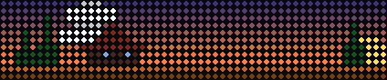

**All year.** The sky right now: sun or moon, clouds, rain, snow, lightning.

## Fall

### Apple orchard

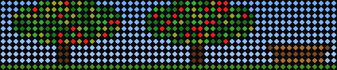

**Sep 1 - Oct 20.** Apple picking: a tree heavy with apples, one dropping now and then into the basket.

### Falling leaves

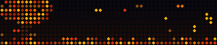

**Sep 10 - Nov 30.** Dusky sky, a little autumn tree, leaves drifting down into piles.

### Scarecrow

**Sep 15 - Oct 31.** A scarecrow in the cornfield under a harvest moon, crows hopping about and flapping off.

### Pumpkin spice latte

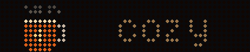

**Sep 20 - Nov 30.** A pumpkin spice latte steaming away.

### Fushimi Inari gates

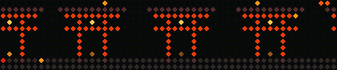

**Oct 1 - Nov 30.** A walk through the thousand red gates of Fushimi Inari, maple leaves falling.

### Ghost

**Oct 1 - Nov 1.** A friendly ghost floating over a graveyard.

### Golden Pavilion

**Oct 1 - Nov 30.** Kinkaku-ji, the Golden Pavilion, glowing over its pond with maples on either side.

### Jack-o'-lanterns

**Oct 1 - Nov 8.** Jack-o'-lanterns flickering under a harvest moon with bats.

### Mt Fuji

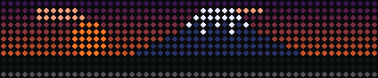

**Oct 1 - Nov 30.** Mt Fuji at sunset with the shinkansen zipping past.

## Winter

### Christmas tree

**Dec 1 - Dec 26.** A Christmas tree with twinkling lights, a shining star and presents underneath, snow outside.

### Hot cocoa

**Dec 1 - Feb 28.** Hot cocoa with marshmallows.

### Northern lights

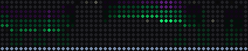

**Dec 1 - Feb 28.** Northern lights rippling over the snowy pines on a cold winter night.

### Santa's sleigh

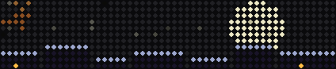

**Dec 1 - Dec 25.** Santa's sleigh flying past a big moon over sleeping rooftops, Rudolph's nose blinking.

### Snowy cabin

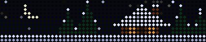

**Dec 1 - Feb 28.** A little log cabin in the snowy pines, window glowing, smoke curling from the chimney.

### Snowman

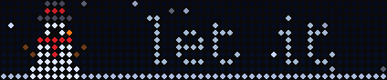

**Dec 10 - Feb 28.** A snowman in a red scarf, waving, with "let it snow" drifting in beside him.

### Ice skater

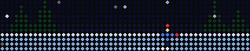

**Dec 15 - Feb 28.** A skater gliding back and forth across a frozen pond, snow falling.

## Spring

### Kite

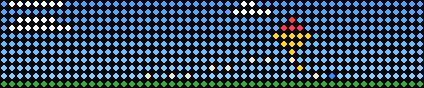

**Mar 1 - May 31.** A breezy spring day: a kite dancing on its string, its tail flicking, clouds racing by.

### April showers

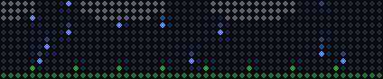

**Mar 18 - Apr 30.** April showers: rain from drifting clouds, tulips pushing up and opening.

### Cherry blossoms

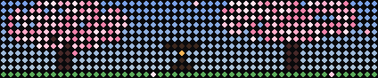

**Mar 20 - Apr 25.** Cherry blossoms in full bloom, petals drifting on the breeze, a lantern glowing (spring in Japan).

### Spring garden

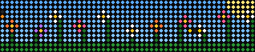

**Apr 1 - May 31.** A spring garden: flowers swaying, a bumblebee buzzing around, a butterfly fluttering by.

## Summer

### Beach

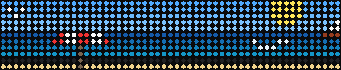

**Jun 1 - Aug 31.** The beach: waves rolling in, a sailboat on the horizon, a gull flapping overhead, an umbrella.

### Campfire

**Jun 1 - Nov 10.** A crackling campfire with a tent, pines, sparks and stars.

### Fireflies

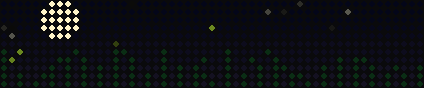

**Jun 1 - Aug 31.** A warm summer night: tall grass swaying, fireflies blinking on and off.

### Ice cream

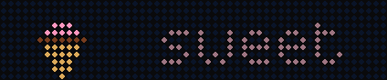

**Jun 1 - Aug 31.** An ice cream cone (no steam!) and summery words.

### Summer storm

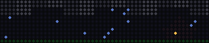

**Jun 15 - Aug 31.** A summer thunderstorm rolling in at dusk: rain, and every so often a crack of lightning.

## Holidays

### MLK Day

**Jan 17 - Jan 18.** MLK Day: the sun rising, a dove with an olive branch, "I have a dream".

### Groundhog Day

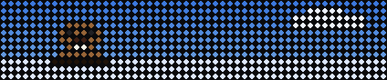

**Jan 30 - Feb 2.** Groundhog Day: he pops up, looks around, sees his shadow.

### Valentine's hearts

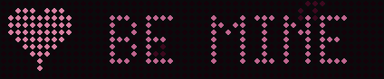

**Feb 1 - Feb 14.** Valentine's conversation hearts: BE MINE, XOXO, HUG ME.

### Stars and stripes

**Feb 15, May 28 - May 31, Jun 28 - Jul 5, Sep 4 - Sep 6, Nov 11.** The stars and stripes, rippling in the breeze (for the flag holidays).

### St. Patrick's rainbow

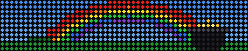

**Mar 1 - Mar 18.** St. Patrick's: a rainbow ending in a pot of gold, shamrocks tumbling across a green hill.

### Pi Day

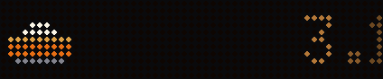

**Mar 13 - Mar 14.** Pi Day (3/14): a pie, and the digits of pi marching past.

### Easter bunny

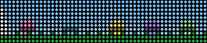

**Mar 14 - Mar 29.** Easter: a bunny hops across the meadow past painted eggs hidden in the grass.

### April Fools'

**Apr 1.** April Fools: the screen is upside down! ...then rights itself.

### Earth Day

**Apr 19 - Apr 22.** Earth Day: our little planet turning in space.

### Cinco de Mayo

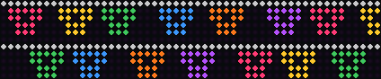

**May 3 - May 5.** Cinco de Mayo: strings of papel picado fluttering, confetti falling.

### Mother's Day bouquet

**May 6 - May 9.** Mother's Day: a bouquet in a vase with little hearts floating up.

### Backyard grill

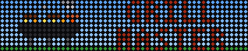

**Jun 17 - Jun 20, Jul 1 - Jul 5.** The backyard grill: burgers sizzling, flames flickering, smoke curling up.

### Juneteenth

**Jun 17 - Jun 19.** Juneteenth: its flag rippling: a bursting star rising over the horizon, red below and blue above.

### Shooting stars

**Aug 8 - Aug 15.** The Perseids (mid August): shooting stars across a dark sky.

### Back to school

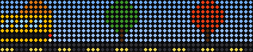

**Aug 28 - Sep 12.** Back to school: the yellow school bus rolls up, stops (stop sign out!), and heads off.

### Thanksgiving turkey

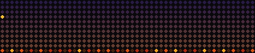

**Nov 1 - Nov 26.** Thanksgiving: a turkey struts across the leaves, stops, fans out his tail.

### Pumpkin pie

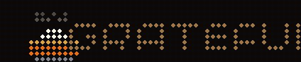

**Nov 11 - Nov 27.** A warm pumpkin pie with a dollop of cream.

### Fireworks

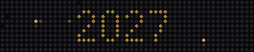

**Dec 31 - Jan 2, Jun 30 - Jul 5.** Fireworks: gold and silver for New Year's (with the year), red, white and blue for the 4th.
